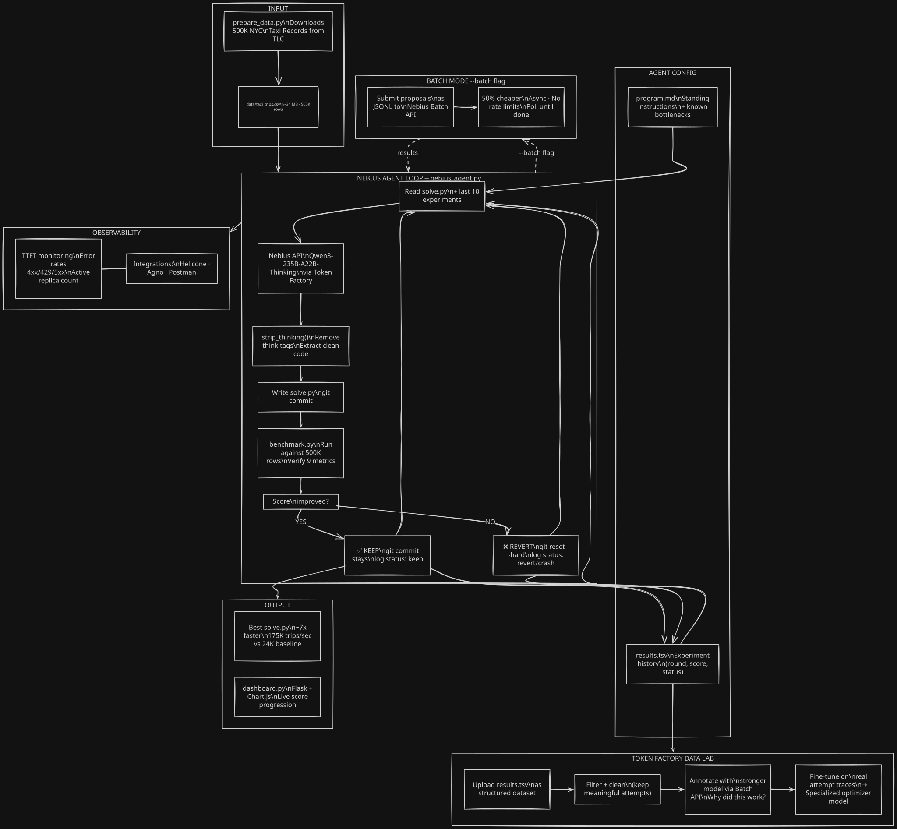

<div align="center">


<br />
<br />

# AutoResearch Pipeline Optimizer on Nebius

### An AI agent that speeds up a taxi analytics pipeline, one commit at a time

An autonomous agent that uses Qwen3-235B on Nebius Token Factory to rewrite a Python analytics pipeline, benchmark it on 500K NYC taxi trips, and keep only the changes that raise throughput.

<br />

[![Built by Studio1](https://img.shields.io/badge/Built_by_Studio1-f97316?style=for-the-badge&logo=data%3Aimage%2Fsvg%2Bxml%3Bbase64%2CPHN2ZyB4bWxucz0iaHR0cDovL3d3dy53My5vcmcvMjAwMC9zdmciIHZpZXdCb3g9IjAgMCAxNjAgMTYwIiBmaWxsPSJub25lIj48cGF0aCBmaWxsLXJ1bGU9ImV2ZW5vZGQiIGNsaXAtcnVsZT0iZXZlbm9kZCIgZD0iTTAgMzVDMCAxNi42ODA3IDE0LjA3NDQgMS42NDg0NCAzMiAwLjEyNjk1M1YxNDFINTEuMDUyM0M1Mi40MzA4IDEzNy4zNDQgNTQuNzQ0NiAxMzMuNjg5IDU3Ljk5MzggMTMwLjAzM0M2MS4xNDQ2IDEyNi41MDggNjQuNjg5MiAxMjMuNDQgNjguNjI3NyAxMjAuODI5QzcyLjU2NjIgMTE4LjM0OSA3Ni4zNTY5IDExNi43ODIgODAgMTE2LjEyOVY4Ni43NTQ0Qzc1LjQ3MDggODcuOTI5MiA3MS4zODQ2IDg5LjY5MTkgNjcuNzQxNSA5Mi4wNDE1QzY0IDk0LjUyMjUgNjAuNzUwOCA5Ny40NiA1Ny45OTM4IDEwMC44NTRDNTYuNTM0NSAxMDIuNzIgNTUuMjU0NSAxMDQuNjU5IDU0LjE1MzkgMTA2LjY3MVYwSDEyNUMxNDQuMzMgMCAxNjAgMTUuNjY5OSAxNjAgMzVWMTI1QzE2MCAxNDQuMzMgMTQ0LjMzIDE2MCAxMjUgMTYwSDEyNFYxOEgxMDQuOTQ4QzEwMy41NjkgMjEuNjgxNiAxMDEuMjU1IDI1LjM2MjggOTguMDA2MiAyOS4wNDQ0Qzk0Ljg1NTQgMzIuNTk0MiA5MS4zMTA4IDM1LjY4NDEgODcuMzcyMyAzOC4zMTRDODMuNDMzOCA0MC44MTIgNzkuNjQzMSA0Mi4zODk2IDc2IDQzLjA0NzRWNzIuNjMwNEM4MC41MjkyIDcxLjQ0NzMgODQuNjE1NCA2OS42NzI0IDg4LjI1ODUgNjcuMzA1N0M5MiA2NC44MDc2IDk1LjI0OTIgNjEuODQ5MSA5OC4wMDYyIDU4LjQzMDdDOTkuNDY1NSA1Ni41NTEzIDEwMC43NDUgNTQuNTk4NiAxMDEuODQ2IDUyLjU3MjNWMTYwSDM1QzE1LjY3IDE2MCAwIDE0NC4zMyAwIDEyNVYzNVoiIGZpbGw9IiNmZmZmZmYiLz48L3N2Zz4K)](https://studio1hq.com)
[](https://nebius.com)

[Nebius docs](https://docs.tokenfactory.nebius.com) &nbsp;·&nbsp; [Nebius](https://nebius.com) &nbsp;·&nbsp; [More examples](https://github.com/Studio1HQ) &nbsp;·&nbsp; [studio1hq.com](https://studio1hq.com)

</div>

<br />

## Overview

This project applies the [autoresearch](https://github.com/karpathy/autoresearch) pattern to data engineering instead of ML training. An agent reads `solve.py`, asks a reasoning model on [Nebius Token Factory](https://docs.nebius.com/studio/inference/token-factory) for a faster version, benchmarks it against 500,000 real NYC Yellow Taxi trip records, and keeps the change only if the score improves and every output is still correct. Otherwise it reverts with `git reset`.

The repo includes the agent, a fixed benchmark harness, the pipeline being optimised, and a live Flask dashboard. `BLOG_TUTORIAL.md` has the full write-up.

## Features

- **Autonomous loop**: propose a change, write `solve.py`, commit, benchmark, then keep or revert.
- **Real data**: January 2024 NYC Yellow Taxi trips from the NYC TLC open data portal, sampled to 500K clean rows.
- **Correctness gate**: nine analytics metrics are checked against a golden reference, and the score is 0 if any output is wrong.
- **Reasoning model**: uses `Qwen/Qwen3-235B-A22B-Thinking-2507` through the OpenAI-compatible Nebius API.
- **Batch mode**: `--batch` sends proposals as one async Nebius Batch API job, described as 50% cheaper.
- **Live dashboard**: Flask and Chart.js page with a score chart, stats, the current `solve.py`, a run log and start/stop controls.
- **Dry runs**: `--dry-run` prints proposals without executing them.

## Tech stack

| Layer | Tool |
| --- | --- |
| LLM | [Nebius Token Factory](https://docs.nebius.com/studio/inference/token-factory), Qwen3-235B-A22B-Thinking |
| Client | [OpenAI Python SDK](https://github.com/openai/openai-python) with a custom base URL |
| Data | [pandas](https://pandas.pydata.org), [pyarrow](https://arrow.apache.org/docs/python/), NYC TLC trip records |
| Dashboard | [Flask](https://flask.palletsprojects.com) and [Chart.js](https://www.chartjs.org) |
| Versioning | git, one commit per experiment |
| Language | Python 3.10 or later |

## Getting started

### Prerequisites

- Python 3.10 or later
- git
- A Nebius API key from [Nebius AI Studio](https://studio.nebius.com/)

### Installation

This repo's default branch is `autoresearch/mar30`, and a plain clone checks it out.

```bash
git clone https://github.com/Studio1HQ/nebius-autoresearch.git
cd nebius-autoresearch
pip install -r requirements.txt
```

### Environment variables

| Variable | Description |
| --- | --- |
| `NEBIUS_API_KEY` | Nebius API key. See `.env.example`. Set it with `export NEBIUS_API_KEY="..."` (Linux, macOS) or `$env:NEBIUS_API_KEY = "..."` (PowerShell). |

### Run

Prepare the data once (about 40 seconds). It downloads the January 2024 trips from the [NYC TLC open data portal](https://www.nyc.gov/site/tlc/about/tlc-trip-record-data.page), samples 500K clean rows and saves `data/taxi_trips.csv`:

```bash
python prepare_data.py
```

Run the baseline benchmark:

```bash
python benchmark.py
```

Start the agent:

```bash
# 20 experiments with real-time API calls
python nebius_agent.py --setup-branch run1 --n-experiments 20

# 50 experiments with batch inference
python nebius_agent.py --n-experiments 50 --batch

# run until you press Ctrl-C
python nebius_agent.py
```

Optionally start the dashboard and open <http://localhost:5000>:

```bash
python dashboard.py
```

| Flag | Description |
| --- | --- |
| `--n-experiments N` | Number of experiments to run. Default is infinite. |
| `--batch` | Use Nebius batch inference, async. |
| `--dry-run` | Show proposals without executing them. |
| `--setup-branch TAG` | Create an `autoresearch/TAG` branch before starting. |

## How it works

```text
nebius_agent.py    optimisation loop (Nebius API + git)
benchmark.py       fixed evaluation harness, do not modify
solve.py           analytics pipeline, the only file the agent edits
prepare_data.py    downloads and samples the taxi data
dashboard.py       Flask dashboard, template in templates/index.html
program.md         standing instructions for the agent
results.tsv        experiment log, written automatically
BLOG_TUTORIAL.md   full write-up
```

Each round the agent sends `solve.py` and the experiment history to the model and parses a code block and short description from the reply. It writes `solve.py`, commits, and runs `benchmark.py`. If the score improved, the commit stays and the result is logged to `results.tsv`. If not, it resets the commit.

`solve.py` computes nine metrics: `payment_revenue`, `hourly_avg_tip`, `passenger_distribution`, `distance_stats`, `duration_p95_minutes`, `busiest_hours`, `top_routes`, `avg_fare_per_mile_by_hour` and `daily_revenue`. The score is `num_trips / processing_time_seconds`, so higher is better.



Batch mode sends all proposals as one JSONL job. The README estimates about $0.40 real-time versus $0.20 batch for 20 rounds, and $1.00 versus $0.50 for 50 rounds.

## Resources

- [BLOG_TUTORIAL.md](BLOG_TUTORIAL.md): full write-up of the project.
- [Karpathy's autoresearch](https://github.com/karpathy/autoresearch): the original idea.
- [Nebius Token Factory](https://docs.nebius.com/studio/inference/token-factory): inference API and models.
- [Nebius docs](https://docs.tokenfactory.nebius.com) and [site](https://nebius.com).
- [NYC TLC trip record data](https://www.nyc.gov/site/tlc/about/tlc-trip-record-data.page): source dataset.

## License

Released under the [MIT License](LICENSE).

<br />

---

<div align="center">

<a href="https://studio1hq.com">
  <picture>
    <source media="(prefers-color-scheme: dark)" srcset="https://raw.githubusercontent.com/Studio1HQ/website/main/brand/studio1-logo-on-dark.svg" />
    
  </picture>
</a>

Built by **[Studio1](https://studio1hq.com)**, the technical content and DevRel partner for devtool teams. Made with [Nebius](https://nebius.com).<br />
Browse more open-source examples at [github.com/Studio1HQ](https://github.com/Studio1HQ).

[](https://studio1hq.com)
[](https://cal.com/studio1/collab)
[](https://x.com/Studio1HQ)
[](https://www.linkedin.com/company/studio1hq/)

<sub><a href="https://studio1hq.com">studio1hq.com</a> · Technical content, docs, video and DevRel for devtools</sub>

</div>
